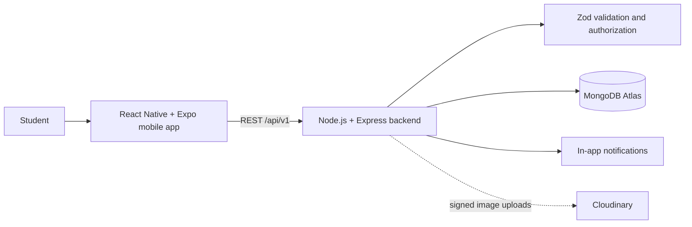

# BorrowBuddy

BorrowBuddy is a student-focused peer-to-peer marketplace for buying, selling,
borrowing and free lending of academic and daily-use items.

The project is a complete mobile-plus-backend system:

- **Mobile:** React Native with Expo and TypeScript.
- **Backend:** Node.js, Express and TypeScript.
- **Database:** MongoDB Atlas through Mongoose.
- **Image architecture:** Cloudinary signed uploads.

## CPAD framework

BorrowBuddy uses **React Native** from the CPAD choices of Flutter, React Native
and Xamarin. Expo is used as React Native development tooling, not as a separate
framework.

## Main features

- Guest listing browsing.
- Registration, login, logout and persistent authentication.
- Secure access-token and rotating refresh-token sessions.
- Listing creation, editing and deactivation.
- Sale and lending listings.
- Quantity-aware sale and lending requests.
- Inclusive lending date overlap validation.
- Provider acceptance and rejection.
- Automatic rejection when requested quantity no longer fits.
- Two-sided handover, receipt and return confirmation.
- Activity filters for own listings, own requests, sales and lending.
- Profile editing, settings and password change.
- Light, dark and system themes.
- Completed-transaction reviews with 1–5 ratings and optional comments.
- In-app notification backend support.

## Architecture



The mobile app does not contain MongoDB credentials, JWT secrets or Cloudinary
signing secrets.

## Repository structure

```text
BorrowBuddy/
├── backend/       Express API, models, validation and tests
├── mobile/        Expo React Native application
├── docs/          Final evaluation report
├── AGENTS.md      Project development instructions
└── BORROWBUDDY_AGENT_HANDOFF.md
```

Component setup details are available in:

- [Backend setup](./backend/README.md)
- [Mobile setup](./mobile/README.md)
- [Final project report](./docs/BorrowBuddy_Final_Project_Report.md)

## Local setup

### Backend

```bash
cd backend
npm install
cp .env.example .env
# Configure MongoDB and non-placeholder JWT secrets in .env
npm run build
npm run dev
```

The backend defaults to `0.0.0.0:4000` for trusted local-network development.
The health endpoint is:

```text
http://localhost:4000/health
```

### Mobile

```bash
cd mobile
npm install
cp .env.example .env
# Set EXPO_PUBLIC_API_URL=http://<laptop-lan-ip>:4000/api/v1
npx expo start -c
```

For a physical Android device, use the laptop's current LAN IP instead of
`localhost`. On Linux, find it with:

```bash
ip -4 addr show wlp2s0
```

The phone and laptop must be on a network that permits device-to-device
connections. College Wi-Fi may use client isolation; in that case use a
personal hotspot, an approved tunnel or a hosted HTTPS backend.

Do not expose port 4000 publicly and do not commit `.env` files.

## Verification

Backend:

```bash
cd backend
npm run build
npm test
```

Mobile:

```bash
cd mobile
npx tsc --noEmit
npx expo-doctor
```

The backend suite includes real MongoDB Atlas authentication, listing persistence
and parallel borrow-approval coverage when `MONGODB_URI` is configured.

## Product boundaries and upcoming work

The current prototype does not process delivery, guarantee physical exchange
safety or provide in-app chat.

Planned or configuration-dependent work includes:

- Live payment-provider onboarding and verified payment processing for
  paid-negotiable lending.
- Production Cloudinary credentials and mobile image selection/upload.
- Reports and protected admin moderation.
- Account deletion after retention and active-transaction policy approval.
- Push notifications.
- Production HTTPS deployment and operational monitoring.

These items are not represented as completed functionality.

## Evaluation demo

Use three accounts:

1. Provider.
2. Requester A.
3. Requester B.

Recommended flow:

1. Register and log in.
2. Restart the app to demonstrate session restoration.
3. Create a listing with quantity.
4. Submit competing sale or lending requests.
5. Accept and reject requests.
6. Demonstrate automatic quantity rejection.
7. Complete handover, receipt and return actions.
8. Submit reviews from both participant accounts.
9. Show Activity filters and transaction details.

## License

This project is maintained as an academic CPAD laboratory project.
