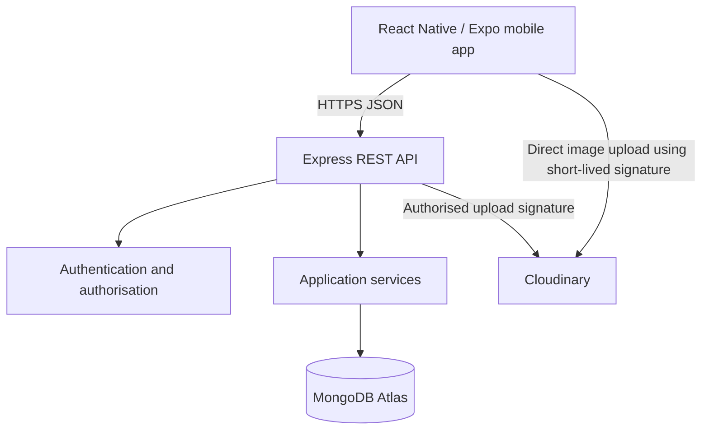
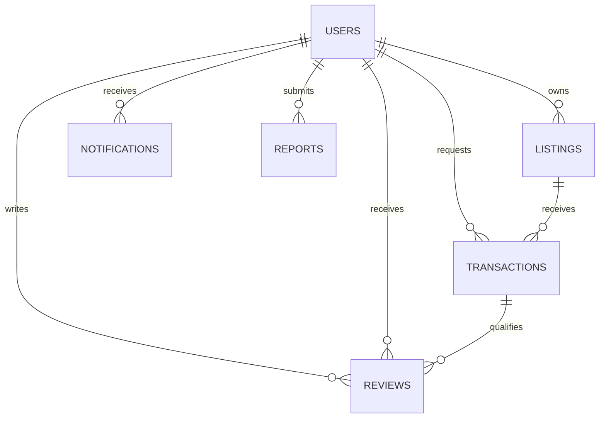

# BorrowBuddy — Database Schema & REST API Contract

**Document ID:** BB-TECH-DB-API  
**Version:** 1.0  
**Status:** Proposed baseline for implementation review  
**Date:** 6 November 2026  
**Supersedes:** The database and API sections of `BorrowBuddy_Technical_Design_v0.1.md`  
**Depends on:** `BorrowBuddy_Requirements_v1.0.md`, `BorrowBuddy_Design_Review_v0.1.md`  
**Project:** BorrowBuddy — A Peer-to-Peer Buy, Sell, Borrow and Lend Marketplace

---

## 0. Document control and authority

This document defines the proposed MongoDB collections, field contracts, indexes, relationships, API routes, payloads, response envelopes, validation and transaction-safety requirements.

It is a **proposed implementation baseline**, not evidence that any code, endpoint, database or test has already been implemented.

### 0.1 Source-of-truth order

If documents conflict, use this order and resolve the conflict explicitly:

1. Latest approved requirements document.
2. Latest approved technical design / database and API contract.
3. Approved decision register.
4. Older drafts and conversation messages.

Do not silently choose between conflicting statements. Record a change and update the affected documents.

### 0.2 Confirmed product decisions

- Target audience: students across different colleges.
- CPAD framework: React Native.
- Mobile tooling: Expo.
- Exchange: physical/offline, arranged by participating users.
- Marketplace activities: buy, sell, borrow and lend.
- Initial listing modes: `SALE` and free `LEND`.
- Paid rentals, in-app payment processing, shipping/delivery and in-app chat are out of the initial release.
- Guest browsing is allowed; authentication is required for account-specific or transaction actions.
- Student status is self-declared in the initial release; the platform must not describe this as verified student status. Email verification is deferred for the first working prototype.
- Contact details are shared only after a request is accepted, and only if the user has chosen to provide them.
- Lending dates are calendar dates interpreted in `Asia/Kolkata`.
- Future non-overlapping lending bookings are allowed.
- In-app notifications are included in the first release; push notifications are deferred.
- Two-way reviews (one per participant per completed transaction) are included after core transaction flows pass testing.
- Listing/user reporting and a protected admin area in the same mobile application are included. Admin accounts are provisioned manually; there is no public admin registration.
- TypeScript is the intended language for both client and server.
- Backend: Node.js + Express; database: MongoDB Atlas; image storage: Cloudinary.

### 0.3 Important implementation assumptions

The following are technical design choices in this document, not additional user-approved product features:

- MongoDB transactions are used for multi-document operations. The selected Atlas deployment must support transactions (replica set or sharded cluster).
- A `reservationVersion` field on each listing serialises competing approval attempts for that listing.
- Transaction state changes are performed by dedicated backend action endpoints, never by arbitrary client-supplied status updates.
- Listing images are uploaded through a server-authorised Cloudinary flow. Cloudinary credentials remain server-side.
- The API is versioned under `/api/v1`.
- IDs are MongoDB ObjectIds represented as 24-character hexadecimal strings in JSON.
- All stored timestamps are UTC. Lending date-only values use `YYYY-MM-DD` and are interpreted in `Asia/Kolkata`.

### 0.4 Not in this contract

- Payment gateway, escrow, deposits or refunds.
- Paid rental pricing.
- Delivery/shipping workflows.
- Chat or direct messaging.
- Push notification provider.
- Government/student identity verification.
- Geospatial search or map-based discovery.
- Automated dispute resolution.

---

## 1. System boundary



The mobile app must never connect directly to MongoDB or hold database credentials. It must not hold Cloudinary API secrets. All business rules and permissions are enforced by the API.

### 1.1 Backend modules

- `auth`: registration, login, token refresh, logout, password reset.
- `users`: profile retrieval and update.
- `listings`: create, edit, deactivate, browse, search and image metadata.
- `transactions`: sale and borrowing request lifecycles.
- `reviews`: transaction-bound reviews.
- `notifications`: in-app notification listing and read state.
- `reports`: user/listing reports.
- `admin`: moderation and account actions.
- `uploads`: secure Cloudinary upload authorisation.

---

## 2. Shared data conventions

### 2.1 Common conventions

- MongoDB collection names are lowercase plural nouns.
- Each document has `_id: ObjectId`.
- Documents use `createdAt` and `updatedAt` as UTC BSON Dates unless a field is explicitly date-only.
- References are stored as ObjectIds.
- Monetary amounts are integer paise, not floating-point rupees. Example: ₹125.50 is `12550` paise.
- Do not store passwords, OTPs, access tokens or refresh tokens in plaintext.
- API responses serialize ObjectIds as strings and Dates as ISO-8601 UTC strings.
- User-supplied strings are trimmed and length-limited on the server.
- Unknown fields are rejected or ignored according to the endpoint validation policy; never mass-assign request bodies to database documents.

### 2.2 Common enumerations

**Account status**
- `ACTIVE`
- `SUSPENDED`
- `DEACTIVATED`

**Account role**
- `STUDENT`
- `ADMIN`

Role assignment is server-controlled. Public registration always creates `STUDENT`.

**Listing type**
- `SALE`
- `LEND`

**Item condition**
- `NEW`
- `LIKE_NEW`
- `GOOD`
- `FAIR`

**Listing status**
- For `SALE`: `AVAILABLE`, `RESERVED`, `SOLD`, `INACTIVE`
- For `LEND`: `ACTIVE`, `INACTIVE`

**Transaction type**
- `SALE`
- `BORROW`

**Transaction status**
- `PENDING`
- `ACCEPTED`
- `HANDOVER_PENDING`
- `ACTIVE` (borrow only)
- `RETURN_PENDING` (borrow only)
- `COMPLETED`
- `REJECTED`
- `CANCELLED`
- `CANCELLED_BY_ADMIN` (admin-only exceptional action, with audit reason)

`OVERDUE` is **derived**, not a persisted transaction status: transaction status is `ACTIVE`, borrower return has not been marked, and current local date is later than `expectedReturnDate` in `Asia/Kolkata`.

**Report status**
- `OPEN`
- `UNDER_REVIEW`
- `RESOLVED`
- `DISMISSED`

---

## 3. MongoDB collection schemas

The schema descriptions below are normative for the initial implementation. Optional fields may be absent; do not store empty strings as substitutes for missing optional values.

### 3.1 `users`

Purpose: authentication identity, student profile, account state and role.

```ts
type User = {
  _id: ObjectId;
  fullName: string;                 // required, 2–80 chars
  email: string;                    // required, normalized lowercase
  passwordHash: string;             // required, bcrypt hash; never returned
  collegeName: string;              // required, 2–120 chars; self-declared
  profileImage?: {
    publicId: string;
    secureUrl: string;
  };
  phoneNumber?: string;             // optional; never public by default
  preferredContactMethod?: "PHONE" | "EMAIL"; // optional, private
  role: "STUDENT" | "ADMIN";         // server controlled
  accountStatus: "ACTIVE" | "SUSPENDED" | "DEACTIVATED";
  emailVerifiedAt?: Date;           // only if verification is implemented
  refreshTokenHash?: string;        // hash only; or use separate sessions collection
  createdAt: Date;
  updatedAt: Date;
  lastLoginAt?: Date;
};
```

Rules:
- `email` must be unique after normalization.
- Public profile responses must omit `passwordHash`, `refreshTokenHash`, private phone number and internal moderation fields.
- `collegeName` is self-declared and must not be labelled verified.
- Registration cannot choose `role` or `accountStatus`.
- Prefer a separate `sessions` collection if multiple-device sessions are required. For a simple first release, one refresh-token hash per account is acceptable but limits concurrent sessions.

### 3.2 `listings`

Purpose: sale and free-lending item listings.

```ts
type Listing = {
  _id: ObjectId;
  ownerId: ObjectId;                 // ref users
  title: string;                     // required, 3–100 chars
  description: string;               // required, 10–2000 chars
  category: string;                  // controlled category slug
  condition: "NEW" | "LIKE_NEW" | "GOOD" | "FAIR";
  listingType: "SALE" | "LEND";
  images: Array<{
    publicId: string;
    secureUrl: string;
    width?: number;
    height?: number;
  }>;                                // 1–5 images
  sale?: {
    pricePaise: number;              // required for SALE, integer > 0
  };
  lend?: {
    minDays?: number;                // optional policy; positive integer
    maxDays?: number;                // optional policy; >= minDays
    advanceNoticeDays?: number;      // default 0
    notes?: string;                  // optional
  };
  status: "AVAILABLE" | "RESERVED" | "SOLD" | "INACTIVE"
       | "ACTIVE";                    // valid value depends on listingType
  reservationVersion: number;        // default 0; incremented in reservation transaction
  createdAt: Date;
  updatedAt: Date;
  deactivatedAt?: Date;
  soldAt?: Date;
};
```

Rules:
- `SALE` requires `sale.pricePaise` and must not contain `lend`.
- `LEND` requires `lend` or an empty lending-policy object and must not contain `sale`.
- For `SALE`, valid statuses are `AVAILABLE`, `RESERVED`, `SOLD`, `INACTIVE`.
- For `LEND`, valid statuses are `ACTIVE`, `INACTIVE`.
- Owner cannot request their own listing.
- Images are Cloudinary assets; only server-authorised upload metadata is accepted. Allow up to 5 JPEG, PNG or WebP images, maximum 5 MB each, subject to verification against Cloudinary account limits.
- Listing owner cannot delete/deactivate an item with an accepted or active transaction. Prefer soft deactivation over physical deletion.
- A listing with historical transactions should not be hard-deleted.

**Controlled category values:** `BOOKS_STUDY_MATERIALS`, `ELECTRONICS_GADGETS`, `CALCULATORS`, `LAB_WORKSHOP_EQUIPMENT`, `SPORTS_FITNESS`, `HOSTEL_DAILY_ESSENTIALS`, `ACCESSORIES`, `OTHER`. Store stable slugs; display labels are mapped in configuration. Do not accept arbitrary category strings.

### 3.3 `transactions`

Purpose: sale requests and borrowing requests, including handover and return acknowledgements.

```ts
type Transaction = {
  _id: ObjectId;
  listingId: ObjectId;               // ref listings
  listingOwnerId: ObjectId;          // immutable snapshot of owner
  requesterId: ObjectId;            // buyer or borrower
  type: "SALE" | "BORROW";
  status: TransactionStatus;
  idempotencyKey: string;            // supplied by client per create attempt
  requestMessage?: string;           // optional, max 500 chars
  sale?: {
    agreedPricePaise: number;        // copied from listing at acceptance
    sellerHandoverConfirmedAt?: Date;
    buyerReceiptConfirmedAt?: Date;
  };
  borrow?: {
    startDate: string;               // YYYY-MM-DD, Asia/Kolkata calendar date
    expectedReturnDate: string;      // YYYY-MM-DD, > startDate
    lenderHandoverConfirmedAt?: Date;
    borrowerReceiptConfirmedAt?: Date;
    borrowerReturnMarkedAt?: Date;
    lenderReturnConfirmedAt?: Date;
    returnIssueReason?: string;      // if lender disputes return
  };
  acceptedAt?: Date;
  rejectedAt?: Date;
  cancelledAt?: Date;
  completedAt?: Date;
  cancellationReason?: string;
  statusHistory: Array<{
    from: string | null;
    to: string;
    actorId: ObjectId;
    actorRole: "STUDENT" | "ADMIN" | "SYSTEM";
    reason?: string;
    at: Date;
  }>;
  createdAt: Date;
  updatedAt: Date;
};
```

Rules:
- `listingOwnerId` is copied from the listing at request creation and is immutable. It is not a replacement for checking the listing's current owner during creation.
- `requesterId` must differ from `listingOwnerId`.
- `type` must match listing type: `SALE` maps to `SALE`; `BORROW` maps to `LEND`.
- `idempotencyKey` is unique per requester and transaction-creation operation. Store a unique compound index on `{ requesterId, idempotencyKey }`.
- `statusHistory` is append-only and updated only by backend transition services.
- Do not accept a full transaction object or arbitrary `status` from clients.
- Sale `agreedPricePaise` is snapshotted when accepted, so later listing edits cannot rewrite an agreed transaction.
- Borrow date-only strings must be valid calendar dates and compared in `Asia/Kolkata`.
- `OVERDUE` is derived for `ACTIVE` borrow transactions where the borrower has not marked return and current local date is later than `expectedReturnDate`. A `RETURN_PENDING` transaction awaiting lender confirmation is unresolved, not automatically overdue.

### 3.4 `reviews`

Purpose: transaction-bound ratings between participants.

```ts
type Review = {
  _id: ObjectId;
  transactionId: ObjectId;           // ref transactions
  reviewerId: ObjectId;              // ref users
  revieweeId: ObjectId;              // ref users
  rating: number;                    // integer 1–5
  comment?: string;                  // optional, max 500 chars
  createdAt: Date;
};
```

Rules:
- Transaction must be `COMPLETED`.
- Reviewer and reviewee must be the two participants.
- Reviewer cannot review themselves.
- One review per reviewer per transaction. If both directions are permitted, unique key is `{ transactionId, reviewerId }`.
- Moderation/reporting may hide a review, but preserve audit history if hidden.

### 3.5 `notifications`

Purpose: in-app event notifications.

```ts
type Notification = {
  _id: ObjectId;
  recipientId: ObjectId;             // ref users
  actorId?: ObjectId;                // ref users, absent for system events
  type: string;                      // controlled event enum
  title: string;                     // max 100 chars
  body: string;                      // max 300 chars
  resourceType?: "LISTING" | "TRANSACTION" | "REVIEW" | "REPORT";
  resourceId?: ObjectId;
  readAt?: Date;
  createdAt: Date;
};
```

Rules:
- Notification creation is server-side.
- Client may mark its own notification as read, but cannot edit recipient, actor, type or content.
- Do not expose another user's notifications.
- Use pagination; do not fetch all notifications at once.

### 3.6 `reports`

Purpose: user-submitted reports and administrator moderation.

```ts
type Report = {
  _id: ObjectId;
  reporterId: ObjectId;              // ref users
  targetType: "LISTING" | "USER" | "REVIEW";
  targetId: ObjectId;
  reason: "SPAM" | "INAPPROPRIATE" | "MISLEADING"
        | "SUSPICIOUS" | "HARASSMENT" | "OTHER";
  description?: string;              // max 1000 chars
  status: "OPEN" | "UNDER_REVIEW" | "RESOLVED" | "DISMISSED";
  assignedAdminId?: ObjectId;
  resolutionNote?: string;
  resolvedAt?: Date;
  createdAt: Date;
  updatedAt: Date;
};
```

Rules:
- Reporter must be authenticated and cannot report a target they do not identify.
- Only admins can change moderation status or resolution details.
- Do not automatically suspend a user solely because a report was submitted.
- Preserve report records for audit.

### 3.7 `adminAuditLogs`

Purpose: immutable audit trail for administrator interventions.

```ts
type AdminAuditLog = {
  _id: ObjectId;
  adminId: ObjectId;
  action: string;
  targetType: "USER" | "LISTING" | "TRANSACTION" | "REPORT" | "REVIEW";
  targetId: ObjectId;
  reason: string;                    // required, max 1000 chars
  metadata?: Record<string, unknown>; // allowlisted, no secrets
  createdAt: Date;
};
```

Rules:
- Only backend admin services create records.
- Logs are append-only and cannot be edited/deleted through the application.
- Every admin suspension, reactivation, listing removal and transaction intervention must create a log entry.

### 3.8 Optional `sessions` collection

Use only if multi-device refresh sessions are required.

```ts
type Session = {
  _id: ObjectId;
  userId: ObjectId;
  refreshTokenHash: string;
  deviceLabel?: string;
  expiresAt: Date;
  revokedAt?: Date;
  createdAt: Date;
};
```

A TTL index on `expiresAt` may clean expired sessions, but explicit logout/revocation must still be supported. TTL deletion is asynchronous and must not be used as an authorisation check.

---

## 4. Relationships



Relationship details:
- One user can own many listings.
- One listing can have many historical transaction requests.
- Each transaction references one listing, one requester and one listing owner.
- One completed transaction can have up to two reviews, one in each direction.
- One user can receive many notifications.
- One user can submit many reports.
- Reports refer polymorphically to a listing, user or review through `targetType` + `targetId`.

MongoDB does not enforce foreign-key constraints. The backend must verify referenced documents and ownership. Use transactions where multiple documents must change atomically.

---

## 5. Index plan

Create indexes through version-controlled migrations/scripts. Do not create indexes ad hoc in production.

| Collection | Index | Type / purpose |
|---|---|---|
| `users` | `{ email: 1 }` | Unique; login and duplicate prevention |
| `users` | `{ accountStatus: 1, createdAt: -1 }` | Admin user listing |
| `listings` | `{ listingType: 1, status: 1, createdAt: -1 }` | Marketplace browse |
| `listings` | `{ ownerId: 1, createdAt: -1 }` | User's listings |
| `listings` | `{ category: 1, listingType: 1, status: 1, createdAt: -1 }` | Category filters |
| `listings` | text index on `title`, `description` | Basic text search; validate language/search behaviour |
| `transactions` | `{ requesterId: 1, createdAt: -1 }` | My requests |
| `transactions` | `{ listingOwnerId: 1, status: 1, createdAt: -1 }` | Owner's incoming requests |
| `transactions` | `{ listingId: 1, type: 1, status: 1 }` | Listing lifecycle/conflict queries |
| `transactions` | `{ requesterId: 1, idempotencyKey: 1 }` | Unique idempotency |
| `transactions` | `{ listingId: 1, status: 1, "borrow.startDate": 1, "borrow.expectedReturnDate": 1 }` | Borrow overlap candidate query |
| `reviews` | `{ transactionId: 1, reviewerId: 1 }` | Unique; one review per participant per transaction |
| `reviews` | `{ revieweeId: 1, createdAt: -1 }` | Profile reviews |
| `notifications` | `{ recipientId: 1, createdAt: -1 }` | Notification inbox |
| `notifications` | `{ recipientId: 1, readAt: 1, createdAt: -1 }` | Unread notifications |
| `reports` | `{ status: 1, createdAt: -1 }` | Admin moderation queue |
| `reports` | `{ reporterId: 1, createdAt: -1 }` | User's reports |
| `adminAuditLogs` | `{ targetType: 1, targetId: 1, createdAt: -1 }` | Audit history for a target |
| `adminAuditLogs` | `{ adminId: 1, createdAt: -1 }` | Actions performed by an admin |
| `sessions` | `{ expiresAt: 1 }` | Optional TTL cleanup |

Index notes:
- The `users.email` unique index requires normalising email before insert.
- The `reviews` unique index should be created only after checking existing data for duplicates.
- Text indexes have limitations and one text index per collection. For larger search needs, evaluate Atlas Search later; do not add it to the initial implementation without need.
- Compound index order must be checked against actual query filters and sort order.
- The borrow overlap index helps candidate lookup but does **not** enforce non-overlap by itself.
- A unique partial index on active borrowing date ranges cannot enforce arbitrary interval non-overlap.

---

## 6. Transaction state machines

### 6.1 Sale

Allowed transitions:

| Current | Action | Next | Actor |
|---|---|---|---|
| — | Create request | `PENDING` | Buyer |
| `PENDING` | Accept | `ACCEPTED` | Seller |
| `PENDING` | Reject | `REJECTED` | Seller |
| `PENDING` | Withdraw | `CANCELLED` | Buyer |
| `ACCEPTED` | Seller confirms physical handover | `HANDOVER_PENDING` | Seller |
| `HANDOVER_PENDING` | Buyer confirms receipt | `COMPLETED` | Buyer |
| `ACCEPTED` | Cancel with reason | `CANCELLED` | Seller or buyer, under cancellation policy |
| Any eligible nonterminal state | Admin intervention | `CANCELLED_BY_ADMIN` | Admin, reason required |

Rules:
- On acceptance, listing changes `AVAILABLE` → `RESERVED`.
- Competing pending sale requests for the same listing must be rejected/cancelled as part of the same atomic operation.
- On completion, listing changes `RESERVED` → `SOLD`.
- If an accepted sale is cancelled before completion, listing may return to `AVAILABLE` only after a guarded backend check confirms no other accepted sale exists.
- Buyer receipt confirmation is required to complete the sale.
- Do not claim the app verifies money transfer. Payment happens offline and is outside platform control.

### 6.2 Borrow

| Current | Action | Next | Actor |
|---|---|---|---|
| — | Create request | `PENDING` | Borrower |
| `PENDING` | Approve | `ACCEPTED` | Lender |
| `PENDING` | Reject | `REJECTED` | Lender |
| `PENDING` | Withdraw | `CANCELLED` | Borrower |
| `ACCEPTED` | Lender confirms handover | `HANDOVER_PENDING` | Lender |
| `HANDOVER_PENDING` | Borrower confirms receipt | `ACTIVE` | Borrower |
| `ACTIVE` | Borrower marks item returned | `RETURN_PENDING` | Borrower |
| `RETURN_PENDING` | Lender confirms return | `COMPLETED` | Lender |
| `RETURN_PENDING` | Lender disputes return | `ACTIVE` | Lender, reason required |
| `ACCEPTED` | Cancel before handover | `CANCELLED` | Either participant under cancellation policy |
| Any eligible nonterminal state | Admin intervention | `CANCELLED_BY_ADMIN` | Admin, reason required |

Rules:
- Approval reserves the requested calendar interval.
- Handover confirmation is two-sided.
- Borrowing becomes `ACTIVE` only after both lender handover and borrower receipt confirmations.
- Return is complete only after lender confirmation.
- A disputed return returns the transaction to `ACTIVE` and stores the issue reason.
- An active transaction past expected return date is displayed as overdue; no automatic completion or cancellation occurs.
- The lending listing remains `ACTIVE` while future dates are available. Availability is computed from approved/active reservations, not a single global `UNAVAILABLE` flag.

### 6.3 Date overlap rule

Two intervals overlap when:

`newStart <= existingEnd AND newEnd >= existingStart`

For the initial implementation, treat requested dates as inclusive calendar dates in `Asia/Kolkata`. Therefore, a booking ending on 10 November conflicts with another booking starting on 10 November. If same-day turnover is later required, the product must explicitly switch to half-open intervals or time-of-day slots and update this contract.

Only approved reservations and active borrowings block a date range. Pending requests do not reserve the item. Approval must re-check availability atomically.

### 6.4 Critical concurrency strategy

A simple query-then-update is unsafe. Two approval requests could both see a free date range and both approve.

Required approval algorithm for a borrow request:

1. Start a MongoDB session and transaction.
2. Read the target listing and validate it is a lending listing and active.
3. Conditionally update the listing's `reservationVersion` from its observed value to value + 1. This creates a write conflict between concurrent approvals for the same listing.
4. Query accepted/handed-over/active/return-pending borrow transactions for interval overlap, excluding the request being approved.
5. If a conflict exists, abort.
6. Conditionally update the request from `PENDING` to `ACCEPTED`, append status history and set `acceptedAt`.
7. Create the notification in the same transaction.
8. Commit.
9. Retry transient transaction/write-conflict errors according to MongoDB driver guidance, with bounded retries and safe error handling.

The `reservationVersion` update must occur inside the same transaction as the overlap query and request approval. Confirm this strategy with an integration test against the actual Atlas deployment. Never treat a successful local unit test as proof of concurrency safety.

For sale acceptance, use a conditional listing update requiring `status: AVAILABLE`, and change it to `RESERVED` in the same MongoDB transaction as accepting one request and closing competing pending requests.

---

## 7. REST API conventions

### 7.1 Base URL and headers

Base path: `/api/v1`

JSON requests use:
- `Content-Type: application/json`
- `Accept: application/json`
- `Authorization: Bearer <accessToken>` for protected routes.
- `Idempotency-Key: <opaque-client-generated-key>` for transaction creation.

Do not place tokens in query parameters.

### 7.2 Success envelope

Single resource:

```json
{
  "success": true,
  "data": {},
  "meta": {}
}
```

Collection:

```json
{
  "success": true,
  "data": [],
  "meta": {
    "page": 1,
    "limit": 20,
    "total": 0,
    "totalPages": 0
  }
}
```

### 7.3 Error envelope

```json
{
  "success": false,
  "error": {
    "code": "VALIDATION_ERROR",
    "message": "The request contains invalid fields.",
    "details": [
      { "field": "title", "message": "Title is required." }
    ],
    "requestId": "server-generated-correlation-id"
  }
}
```

Do not expose stack traces, database errors, secrets or internal implementation details.

### 7.4 HTTP status conventions

- `200 OK`: successful read/update/action.
- `201 Created`: resource created.
- `204 No Content`: successful deletion/revocation with no body.
- `400 Bad Request`: malformed request or invalid input.
- `401 Unauthorized`: missing/invalid authentication.
- `403 Forbidden`: authenticated but not permitted.
- `404 Not Found`: resource does not exist or is not visible to caller.
- `409 Conflict`: state conflict, duplicate request, unavailable listing or overlapping booking.
- `422 Unprocessable Entity`: well-formed request that fails domain validation, if used consistently.
- `429 Too Many Requests`: rate limit.
- `500 Internal Server Error`: unexpected server error.

---

## 8. REST API endpoint contract

All routes below are under `/api/v1`. `Public` means no login required. `Student` means authenticated active student. `Participant` means the buyer/seller or borrower/lender on that transaction. `Admin` means authenticated admin.

### 8.1 Authentication

| Method | Route | Access | Purpose |
|---|---|---|---|
| POST | `/auth/register` | Public | Create student account |
| POST | `/auth/login` | Public | Authenticate |
| POST | `/auth/refresh` | Refresh token | Issue new access token |
| POST | `/auth/logout` | Student | Revoke refresh session |
| POST | `/auth/forgot-password` | Public | Start password reset |
| POST | `/auth/reset-password` | Public with reset token | Set new password |
| GET | `/auth/me` | Student | Get current account |

**Register request**

```json
{
  "fullName": "Aarav Patel",
  "email": "aarav@example.edu",
  "password": "user-supplied-password",
  "collegeName": "Example College"
}
```

Server behaviour:
- Normalise email to lowercase and trim.
- Validate password policy.
- Hash password with bcrypt.
- Set `role: STUDENT`, `accountStatus: ACTIVE`.
- Never accept role/status from request.
- Return safe user profile and tokens/session information.
- If email verification is not implemented, do not return or imply `emailVerifiedAt`.

**Login request**

```json
{
  "email": "aarav@example.edu",
  "password": "user-supplied-password"
}
```

Return safe user object, access token and refresh token according to the chosen secure client storage design. Do not log credentials or tokens.

### 8.2 User profiles

| Method | Route | Access | Purpose |
|---|---|---|---|
| GET | `/users/:userId` | Public | Public profile |
| PATCH | `/users/me` | Student | Update own profile |
| GET | `/users/me/listings` | Student | Own listings |
| GET | `/users/:userId/reviews` | Public | Public reviews |

`PATCH /users/me` allowlist:
- `fullName`
- `collegeName`
- `phoneNumber`
- `profileImage` (only verified Cloudinary asset metadata)

Never allow a student to patch `role`, `accountStatus`, `email`, `passwordHash` or moderation fields through this route.

### 8.3 Listings

| Method | Route | Access | Purpose |
|---|---|---|---|
| GET | `/listings` | Public | Browse/search/filter |
| GET | `/listings/:listingId` | Public | Listing detail |
| POST | `/listings` | Student | Create listing |
| PATCH | `/listings/:listingId` | Owner | Edit eligible listing |
| POST | `/listings/:listingId/deactivate` | Owner | Deactivate listing |
| POST | `/listings/:listingId/reactivate` | Owner | Reactivate eligible listing |
| POST | `/uploads/signature` | Student | Obtain short-lived Cloudinary upload signature |

Browse query parameters:
- `q`: optional search text.
- `listingType`: `SALE` or `LEND`.
- `category`: category slug.
- `condition`: item condition.
- `page`: default 1.
- `limit`: default 20, maximum 50.
- `sort`: `newest` initially.

Only public, active/available listings are returned by default. A sale listing with status `RESERVED`, `SOLD` or `INACTIVE` is excluded from normal marketplace results.

**Create sale listing request**

```json
{
  "title": "Scientific Calculator",
  "description": "Casio scientific calculator in good working condition.",
  "category": "calculators",
  "condition": "GOOD",
  "listingType": "SALE",
  "images": [
    { "publicId": "borrowbuddy/items/abc123", "secureUrl": "https://res.cloudinary.com/example/image/upload/abc123.jpg" }
  ],
  "sale": {
    "pricePaise": 45000
  }
}
```

**Create lending listing request**

```json
{
  "title": "Engineering Drawing Set",
  "description": "Complete drawing set available for temporary borrowing.",
  "category": "stationery",
  "condition": "LIKE_NEW",
  "listingType": "LEND",
  "images": [
    { "publicId": "borrowbuddy/items/def456", "secureUrl": "https://res.cloudinary.com/example/image/upload/def456.jpg" }
  ],
  "lend": {
    "minDays": 1,
    "maxDays": 7,
    "advanceNoticeDays": 0,
    "notes": "Please return all components."
  }
}
```

Server must verify that image `publicId` values belong to the configured Cloudinary account/path and were uploaded through an authorised flow. Do not trust arbitrary client-provided URLs.

Listing update rules:
- Owner only.
- Reject changes to owner, status, reservationVersion, soldAt and transaction references.
- Do not permit listing type changes after any transaction exists.
- Do not permit edits that alter terms of an accepted transaction.
- A reserved or sold sale listing cannot be edited as if available.
- Deactivation must fail while an accepted/active transaction requires the item.

### 8.4 Transactions

| Method | Route | Access | Purpose |
|---|---|---|---|
| POST | `/transactions/sale-requests` | Student | Request to buy a sale listing |
| POST | `/transactions/borrow-requests` | Student | Request a lending date range |
| GET | `/transactions/me` | Student | List own incoming/outgoing transactions |
| GET | `/transactions/:transactionId` | Participant | Transaction detail |
| POST | `/transactions/:transactionId/share-contact` | Participant | Share opted-in contact method with the other participant after acceptance |
| POST | `/transactions/:transactionId/accept` | Listing owner | Accept pending request |
| POST | `/transactions/:transactionId/reject` | Listing owner | Reject pending request |
| POST | `/transactions/:transactionId/cancel` | Eligible participant | Cancel under policy |
| POST | `/transactions/:transactionId/seller-handover` | Sale seller | Confirm physical sale handover |
| POST | `/transactions/:transactionId/buyer-receipt` | Sale buyer | Confirm receipt and complete sale |
| POST | `/transactions/:transactionId/lender-handover` | Lender | Confirm item handover |
| POST | `/transactions/:transactionId/borrower-receipt` | Borrower | Confirm receipt and activate borrowing |
| POST | `/transactions/:transactionId/borrower-return` | Borrower | Mark item returned |
| POST | `/transactions/:transactionId/lender-return-confirmation` | Lender | Confirm return and complete borrowing |
| POST | `/transactions/:transactionId/lender-return-dispute` | Lender | Dispute return with reason |

**Create sale request**

`POST /transactions/sale-requests`

Header: `Idempotency-Key: <unique-key>`

```json
{
  "listingId": "665000000000000000000001",
  "requestMessage": "I am interested and can meet on campus."
}
```

**Create borrowing request**

`POST /transactions/borrow-requests`

Header: `Idempotency-Key: <unique-key>`

```json
{
  "listingId": "665000000000000000000002",
  "startDate": "2026-11-10",
  "expectedReturnDate": "2026-11-12",
  "requestMessage": "I need this for a lab assignment."
}
```

Server validates:
- Listing exists, is active and has matching type.
- Requester is authenticated, active and not the owner.
- Dates are valid calendar dates in `Asia/Kolkata`.
- End date is after start date.
- Requested duration respects listing's `minDays`/`maxDays` if configured.
- Request is not a duplicate idempotent submission.
- Do not guarantee availability at request creation if requests are pending; availability is revalidated atomically at approval.

**Accept request**

`POST /transactions/:transactionId/accept`

No client-supplied status is accepted. The backend identifies the transaction type and executes the appropriate sale or borrowing approval algorithm.

For borrowing approval, the body is empty. For sale approval, the body is empty. Any negotiated price change is out of initial scope; accepted sale price is copied from listing.

**Reject request**

```json
{
  "reason": "The item is not available for the requested period."
}
```

Reason optional, max 300 chars.

**Cancel request**

```json
{
  "reason": "Plans changed."
}
```

Cancellation policy:
- Requester may withdraw while `PENDING`; owner may reject.
- Before physical handover, either participant may cancel an accepted transaction with a reason. For a sale, restore the listing to `AVAILABLE`; previous pending requests remain closed and interested users must submit fresh requests.
- After handover starts, ordinary cancellation is not allowed. Use issue reporting and admin review.
- Admin intervention requires an explicit reason and audit entry.

**Handover/receipt actions**
- Action routes accept no arbitrary status field.
- Backend validates actor role and current state.
- Each acknowledgement timestamp is set by server time.
- Sale completes only after seller handover and buyer receipt.
- Borrowing becomes active only after lender handover and borrower receipt.
- Borrowing completes only after borrower return mark and lender return confirmation.

### 8.5 Contact sharing

`POST /transactions/:transactionId/share-contact` is available only to a participant after acceptance. The server checks that the caller has configured an optional preferred contact method. The response exposes only that opted-in method to the other participant in this transaction; contact details are never included in public profile or listing responses. No in-app chat is provided.

### 8.6 Reviews

| Method | Route | Access | Purpose |
|---|---|---|---|
| POST | `/transactions/:transactionId/reviews` | Participant | Submit review after completion |
| GET | `/transactions/:transactionId/reviews` | Public | List transaction reviews, if public display is enabled |

Request:

```json
{
  "rating": 5,
  "comment": "Friendly and punctual."
}
```

The server derives reviewer from authentication and reviewee from the other transaction participant. Client must not submit arbitrary reviewer/reviewee IDs.

### 8.7 Notifications

| Method | Route | Access | Purpose |
|---|---|---|---|
| GET | `/notifications` | Student | Paginated inbox |
| PATCH | `/notifications/:notificationId/read` | Recipient | Mark one as read |
| POST | `/notifications/read-all` | Student | Mark all own notifications read |

Notification events should be created by backend services as part of the relevant transaction operation where practical. Do not create notifications from client claims.

### 8.8 Reports and moderation

| Method | Route | Access | Purpose |
|---|---|---|---|
| POST | `/reports` | Student | Report listing/user/review |
| GET | `/admin/reports` | Admin | Moderation queue |
| PATCH | `/admin/reports/:reportId` | Admin | Update report review |
| GET | `/admin/users` | Admin | Search/manage users |
| POST | `/admin/users/:userId/suspend` | Admin | Suspend account |
| POST | `/admin/users/:userId/reactivate` | Admin | Reactivate account |
| POST | `/admin/listings/:listingId/remove` | Admin | Remove listing |\n| GET | `/admin/audit-logs` | Admin | View paginated administrative audit history |

Admin actions require role check, reason, audit logging and notification where appropriate. Do not expose admin endpoints to student role.

---

## 9. Validation and error codes

Recommended stable application error codes:

| Code | Meaning |
|---|---|
| `VALIDATION_ERROR` | Request fields invalid |
| `AUTH_REQUIRED` | Authentication missing |
| `INVALID_CREDENTIALS` | Login failed |
| `ACCOUNT_SUSPENDED` | Account cannot perform protected actions |
| `FORBIDDEN` | Caller lacks permission |
| `NOT_FOUND` | Resource not found |
| `LISTING_UNAVAILABLE` | Listing is not requestable |
| `SELF_REQUEST_NOT_ALLOWED` | Owner tried to request own listing |
| `TRANSACTION_STATE_CONFLICT` | Action invalid for current state |
| `DATE_RANGE_INVALID` | Borrowing dates invalid |
| `DATE_RANGE_CONFLICT` | Existing approved/active booking overlaps |
| `DUPLICATE_REQUEST` | Idempotency or duplicate request conflict |
| `REVIEW_NOT_ELIGIBLE` | Transaction not completed or caller not participant |
| `RATE_LIMITED` | Rate limit exceeded |
| `INTERNAL_ERROR` | Unexpected error |

Validation limits (initial proposal):
- Full name: 2–80 chars.
- College name: 2–120 chars.
- Listing title: 3–100 chars.
- Listing description: 10–2000 chars.
- Listing images: 1–5.
- Review comment: 0–500 chars.
- Request message: 0–500 chars.
- Report description: 0–1000 chars.
- Page size: default 20, maximum 50.
- Price: positive safe integer in paise.

All limits must be centralised in shared validation schemas and covered by tests.

---

## 10. Security requirements

1. Hash passwords with bcrypt using an appropriate work factor; never store plaintext.
2. Use short-lived access tokens and refresh-token rotation/revocation.
3. Store secrets in environment variables and never commit `.env`.
4. Enforce ownership and role checks on every protected resource.
5. Validate and sanitise all request bodies, query parameters and path IDs.
6. Rate-limit registration, login, password reset and upload-signature routes.
7. Use HTTPS in deployed environments.
8. Restrict CORS to known app/web origins where applicable.
9. Do not expose private phone numbers or internal account fields in public profile APIs.
10. Use Cloudinary signed uploads; validate returned asset identity and allowed formats/size.
11. Never trust client timestamps for state transitions; use server time.
12. Do not log passwords, tokens, reset codes or private contact details.
13. Avoid mass assignment by explicitly mapping permitted fields.
14. Use generic login failure messages to reduce account enumeration.
15. Apply admin role checks server-side, not merely by hiding UI controls.

---

## 11. Testing contract

Before a route is considered complete, test:

### Authentication
- Registration with valid and invalid data.
- Duplicate email.
- Password hashing.
- Login success/failure.
- Expired/invalid access token.
- Refresh and logout.
- Suspended account access.

### Listings
- Create SALE and LEND.
- Reject malformed listing type/price.
- Owner-only edit/deactivate.
- Guest browse.
- Filter/search/pagination.
- Prevent self-request and inactive listing request.

### Sale transaction
- Buyer creates request.
- Seller accepts/rejects.
- Buyer withdraws pending request.
- Two simultaneous accept attempts: only one succeeds.
- Seller handover and buyer receipt.
- Listing becomes SOLD only after completion.
- Cancellation restores availability only under guarded conditions.

### Borrow transaction
- Valid date request.
- Invalid/reversed dates.
- Overlapping booking rejected at approval.
- Adjacent date semantics match inclusive interval rule.
- Concurrent approvals for same listing do not create overlap.
- Two-sided handover.
- Active and overdue display.
- Return confirmation and dispute.
- Listing remains available for non-overlapping future periods.

### Reviews, notifications and reports
- Review only after completion.
- Duplicate review rejected.
- User sees only own notifications.
- User cannot update another user's notification.
- Only admins can moderate.
- Report submission does not automatically suspend account.

### Concurrency integration tests
Run against a MongoDB deployment with transaction support. Simulate parallel requests. A mock repository or in-memory database is insufficient evidence for transaction isolation behaviour.

---

## 12. API implementation order

1. Health check and server configuration.
2. Database connection and index/migration script.
3. Registration, login, refresh and logout.
4. Current user and profile APIs.
5. Cloudinary upload signature.
6. Listing create/read/update/deactivate and marketplace query.
7. Sale request lifecycle.
8. Borrow request lifecycle and concurrency protection.
9. Notifications.
10. Reviews.
11. Reports and admin moderation.

Build and test each module before integrating the next.

---

## 13. Implementation gates

Do not start full implementation until all checks below are satisfied:

- [ ] Requirements v1.0 and approved defaults are available to the implementation chat.
- [ ] This schema/API contract is reviewed and approved.
- [ ] Atlas deployment supports multi-document transactions.
- [ ] Date interval semantics (inclusive dates) are accepted.
- [x] Cancellation policy after acceptance is approved in the design decision register.
- [ ] Sale completion's two-party confirmation is accepted.
- [ ] Borrow handover and return two-party confirmation are accepted.
- [ ] Contact sharing fields and visibility rules are accepted.
- [ ] API validation schemas and TypeScript types are derived from this contract.
- [ ] Index creation script is reviewed.
- [ ] Concurrency integration-test plan is ready.

---

## 14. Change log

| Version | Date | Change | Status |
|---|---|---|---|
| 0.1 | 6 Nov 2026 | Initial architecture and conceptual data/API outline | Superseded draft |
| 1.0 | 6 Nov 2026 | Detailed collection contracts, indexes, relationships, API routes/payloads, state transitions, concurrency rules, security and test contract | Proposed baseline; owner review required |

## 15. Instructions for future ChatGPT work

- Read the requirements and latest approved design documents before making implementation decisions.
- This document is the API/schema reference only while it remains the latest approved version.
- Do not invent fields, routes, enum values, dependencies, credentials or test results.
- Do not change API payloads or database fields without updating this document and its version.
- Do not implement transaction status as a generic client-editable field.
- Do not claim concurrency safety until the Atlas-backed integration tests pass.
- Keep frontend TypeScript types, backend validation schemas, database models, API docs and tests aligned.
- If a requirement is unclear, identify it as unresolved and ask before making a breaking assumption.
