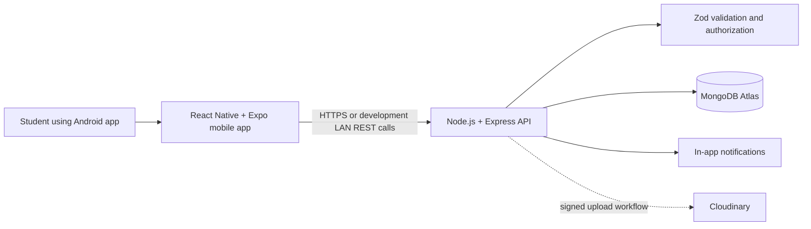
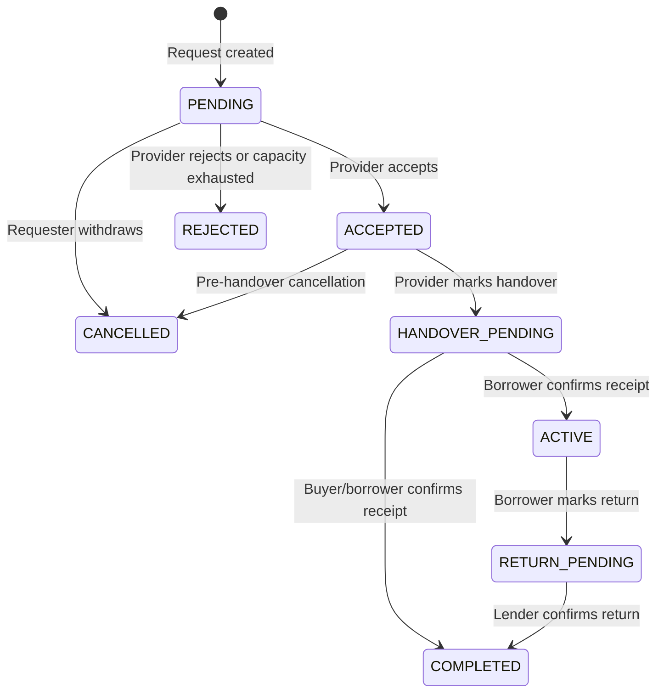

# BorrowBuddy
## Final CPAD Lab Project Report

**Project type:** Student peer-to-peer marketplace  
**Project status:** Core prototype implemented and verified  
**Report date:** 17 November 2026  
**Repository:** `Darsh-KShah/BorrowBuddy`

---

## 1. Abstract

BorrowBuddy is a student-focused marketplace for buying, selling, borrowing and
free lending of items such as books, calculators, electronics, laboratory
equipment and hostel essentials. Students can browse listings as guests, create
their own listings after authentication, request items, and manage the complete
transaction lifecycle.

The project is a complete mobile-plus-backend system rather than only a
frontend application. The mobile app communicates with a TypeScript REST API,
which authenticates users, validates requests, enforces ownership and
transaction rules, and persists data in MongoDB Atlas.

The prototype does not process physical delivery or guarantee offline exchange,
item quality, payment between users or personal safety during an in-person
exchange.

---

## 2. Problem Statement

Students often need short-term access to academic and daily-use items but may
not want to purchase them permanently. Existing informal methods such as
messaging groups do not provide structured listings, request tracking,
availability checks or transaction history.

BorrowBuddy addresses this by providing:

- Searchable student listings.
- Sale and lending workflows.
- Quantity-aware requests.
- Date-aware lending availability.
- Authenticated ownership and transaction controls.
- Two-sided handover, receipt and return confirmation.
- Reviews after completed transactions.

College affiliation is self-declared. BorrowBuddy does not claim official
student verification.

---

## 3. CPAD Framework Selection

### Selected framework: React Native

The project uses **React Native with Expo tooling**.

| Option | Decision |
|---|---|
| Flutter | Not selected |
| React Native | **Selected** |
| Xamarin | Not selected |

React Native was selected because:

- The project uses TypeScript across the mobile and backend layers.
- React Native supports Android development and physical-device testing.
- Expo simplifies development, routing, native modules and local testing.
- The team can reuse React component patterns and JavaScript ecosystem tools.

Expo is development tooling for React Native. It is not treated as a separate
mobile framework choice.

---

## 4. Technology Stack

### Mobile frontend

- React Native
- Expo
- Expo Router
- TypeScript
- React Context for authentication and theme state
- Expo SecureStore for access and refresh tokens
- Native date picker for lending dates

### Backend

- Node.js
- Express
- TypeScript
- Mongoose
- Zod request validation
- JWT access tokens
- Rotating and revocable refresh-token sessions
- bcrypt-based password hashing

### Database and services

- MongoDB Atlas
- Cloudinary signed-upload architecture
- REST API prefix: `/api/v1`

### Runtime architecture



The mobile app never receives MongoDB credentials, JWT signing secrets or
Cloudinary API secrets.

---

## 5. Implemented Features

### 5.1 Authentication and account security

- Registration with full name, email, password and college.
- Login and logout.
- Persistent authentication across app restarts.
- Secure token storage using Expo SecureStore.
- Short-lived access tokens.
- Refresh-token rotation.
- Refresh-token revocation during logout and password change.
- Authenticated `/auth/me` profile retrieval.
- Profile editing for supported fields.
- Password change with current-password verification.
- Notification and contact-sharing preferences.

### 5.2 Marketplace listings

- Guest browsing.
- Listing creation, editing and deactivation.
- Ownership checks on listing modification.
- Sale and lending listing modes.
- Exact category and condition enums.
- Listing quantity and available quantity.
- Listing description, price and lending policy.
- My Listings access from the authenticated profile.
- Meaningful validation and server errors.

Approved categories:

`BOOKS_STUDY_MATERIALS`, `ELECTRONICS_GADGETS`, `CALCULATORS`,
`LAB_WORKSHOP_EQUIPMENT`, `SPORTS_FITNESS`, `HOSTEL_DAILY_ESSENTIALS`,
`ACCESSORIES`, `OTHER`

Approved conditions:

`NEW`, `LIKE_NEW`, `GOOD`, `FAIR`

### 5.3 Sale transactions

- Sale request creation.
- Requested quantity.
- Provider acceptance and rejection.
- Atomic inventory decrement at acceptance.
- Automatic rejection of requests that no longer fit remaining quantity.
- Requester withdrawal.
- Pre-handover cancellation with a reason.
- Seller handover confirmation.
- Buyer receipt confirmation.
- Completion only after both required confirmations.

### 5.4 Lending transactions

- Free lending listings.
- Paid-negotiable lending architecture.
- Requested start and expected-return dates.
- `DD-MM-YYYY` mobile date entry and calendar picker.
- Inclusive date semantics.
- Inclusive overlap rule:

  `newStart <= existingEnd AND newEnd >= existingStart`

- Quantity-aware overlapping bookings.
- Provider acceptance and rejection.
- Automatic rejection when overlapping quantity is exhausted.
- Lender handover confirmation.
- Borrower receipt confirmation.
- Borrower return marking.
- Lender return confirmation.
- Derived overdue handling for qualifying active transactions only.

Pending requests do not reserve inventory or dates.

### 5.5 Activity and transaction management

- Incoming and outgoing transaction list.
- Transaction detail expansion.
- Other participant, item, quantity, dates, cost and status.
- Filters for:
  - All activity
  - My listings
  - My requests
  - All types
  - Sales
  - Lending
- Accept and Reject buttons displayed together.
- Withdraw and cancellation actions where permitted.
- Themed loading, empty and error states.

### 5.6 Reviews

- Review eligibility only after `COMPLETED`.
- One review per participant per completed transaction.
- Rating from 1 to 5.
- Optional feedback comment up to 500 characters.
- Server derives reviewer and reviewee.
- Duplicate review prevention.
- Review display in completed transaction details.
- Reviewer name and rating shown to the recipient.

### 5.7 User experience

- Light, dark and system theme modes.
- Consistent theme across authentication, Home, Explore, Profile, Settings,
  listing details, Activity and forms.
- Keyboard avoidance for forms.
- Search and category browsing.
- Profile empty states.
- Session-expiry handling and API error feedback.

---

## 6. Transaction Lifecycle



Clients cannot submit arbitrary transaction statuses. Each transition uses a
dedicated backend action endpoint with participant and state validation.

---

## 7. Data Model Summary

### User

- Identity and authentication fields.
- Self-declared college affiliation.
- Password hash.
- Role and account status.
- Notification and contact-sharing preferences.

### Listing

- Owner.
- Title, description, category and condition.
- `SALE` or `LEND`.
- Total `quantity`.
- Server-maintained `availableQuantity`.
- Sale price or lending policy.
- Optional verified image references.
- Status and reservation version.

### Transaction

- Listing and participant references.
- `SALE` or `BORROW`.
- `requestedQuantity`.
- Lifecycle status and status history.
- Sale details or borrow dates.
- Handover, receipt, return and completion timestamps.
- Payment and fee negotiation fields for future paid lending.

### Review

- Transaction reference.
- Reviewer and reviewee references.
- Rating from 1 to 5.
- Optional comment.
- Unique `(transactionId, reviewerId)` constraint.

---

## 8. Security and Integrity

- Passwords are hashed and never stored in plaintext.
- Access and refresh tokens are not logged.
- Mobile tokens are stored in SecureStore.
- Refresh tokens are rotated and revocable.
- Protected routes require authentication.
- Ownership and participant checks are enforced server-side.
- Client-supplied status changes are not accepted.
- Request fields are explicitly validated and mapped.
- Server time is used for lifecycle transitions.
- Contact details are not public.
- Contact sharing is participant-scoped and opt-in.
- Upload credentials remain server-side.
- Quantity updates use conditional writes.
- Borrow approval uses a transaction-capable MongoDB Atlas deployment,
  overlap recheck and a shared per-listing reservation version.

---

## 9. Testing and Verification

### Automated verification completed

- Backend TypeScript build.
- Backend unit and validation tests.
- Real Atlas authentication and listing persistence tests.
- Real Atlas parallel borrow-approval test.
- Quantity validation tests.
- Review validation tests.
- Mobile TypeScript check.
- Expo Doctor: 20/20 checks passed.
- Whitespace and diff checks.

### Important verification distinction

The Atlas integration tests use a real MongoDB Atlas deployment. Mobile
TypeScript and Expo Doctor validate the project/tooling, not physical Android
network behavior.

Physical Android verification remains necessary for:

- Registration and login persistence.
- Listing creation.
- Quantity requests.
- Review submission and display.
- Restart/session restoration.
- Current Wi-Fi connectivity.

---

## 10. Planned and Not-Yet-Implemented Features

These items are intentionally not described as complete:

### Payment provider onboarding

The data model and backend architecture support paid-negotiable lending, but live
payment processing requires:

- Provider selection.
- Merchant onboarding.
- Credentials.
- Order creation.
- Verified callbacks/webhooks.
- Sandbox testing.
- Refund and settlement policy.

No live payment processing claim should be made before these prerequisites exist.

### Cloudinary production uploads

Signed-upload backend support exists, but mobile image selection/upload remains
deferred while Cloudinary credentials and production configuration are absent.

### Reports and protected admin area

Planned:

- Listing and user reporting.
- Protected admin access.
- Admin intervention audit logs.
- Moderation actions.

### Account deletion

Disabled until retention, transaction-history and active-transaction policies are
approved.

### Push notifications

In-app notification support is present. Push notifications are deferred.

### Production deployment

The current setup is suitable for development and evaluation. A production
deployment should use hosted HTTPS, protected environment variables, monitoring,
backups and a stable domain.

---

## 11. Demonstration Plan

Use three accounts:

1. Provider.
2. Requester A.
3. Requester B.

Recommended demonstration:

1. Register and log in.
2. Restart the app and show session restoration.
3. Provider creates a listing with quantity 2 or 3.
4. Requesters submit different quantities.
5. Provider accepts one request and demonstrates automatic rejection when
   remaining quantity cannot satisfy another request.
6. Show Activity filters and expanded transaction details.
7. Complete handover, receipt and return actions.
8. Submit reviews from both participant accounts.
9. Show participant name, rating and comment in completed transaction details.
10. Switch theme and show consistent app-wide styling.

---

## 12. Development Network Setup

### Home or lab Wi-Fi with local backend

The backend binds to:

```text
0.0.0.0:4000
```

The Android phone must use the laptop's current LAN address, not `localhost`.
For example:

```env
EXPO_PUBLIC_API_URL=http://192.168.0.106:4000/api/v1
```

The address may change when joining another Wi-Fi network or receiving a new
DHCP lease. Check the current address on Linux with:

```bash
hostname -I
```

Then update the ignored local file `mobile/.env` and restart Expo:

```bash
cd mobile
npx expo start -c
```

### College Wi-Fi limitations

No application code change is normally required. The following must be true:

- Laptop and phone are on the same network.
- The current laptop LAN IP is used in `mobile/.env`.
- Port 4000 is allowed by the laptop firewall.
- College Wi-Fi permits device-to-device traffic.

Some college networks use client isolation, which prevents a phone from
reaching a laptop even when both are connected to the same Wi-Fi. In that case,
the LAN setup cannot be fixed only by changing the IP.

Reliable alternatives are:

- Deploy the backend to a hosted HTTPS service.
- Use an approved development tunnel.
- Use a personal hotspot where the laptop and phone share a private network.

Do not expose port 4000 publicly or commit local `.env` values.

---

## 13. Conclusion

BorrowBuddy demonstrates a complete student marketplace prototype with a React
Native mobile frontend, TypeScript/Express backend and MongoDB Atlas persistence.
The implemented system covers authentication, listing management, quantity-aware
sale and lending transactions, transaction lifecycle controls, reviews, activity
filters and consistent mobile UX.

The remaining work is primarily production readiness and optional platform
features rather than the core marketplace flow: payment-provider onboarding,
Cloudinary production credentials, moderation/admin workflows, account-deletion
policy and hosted deployment.

