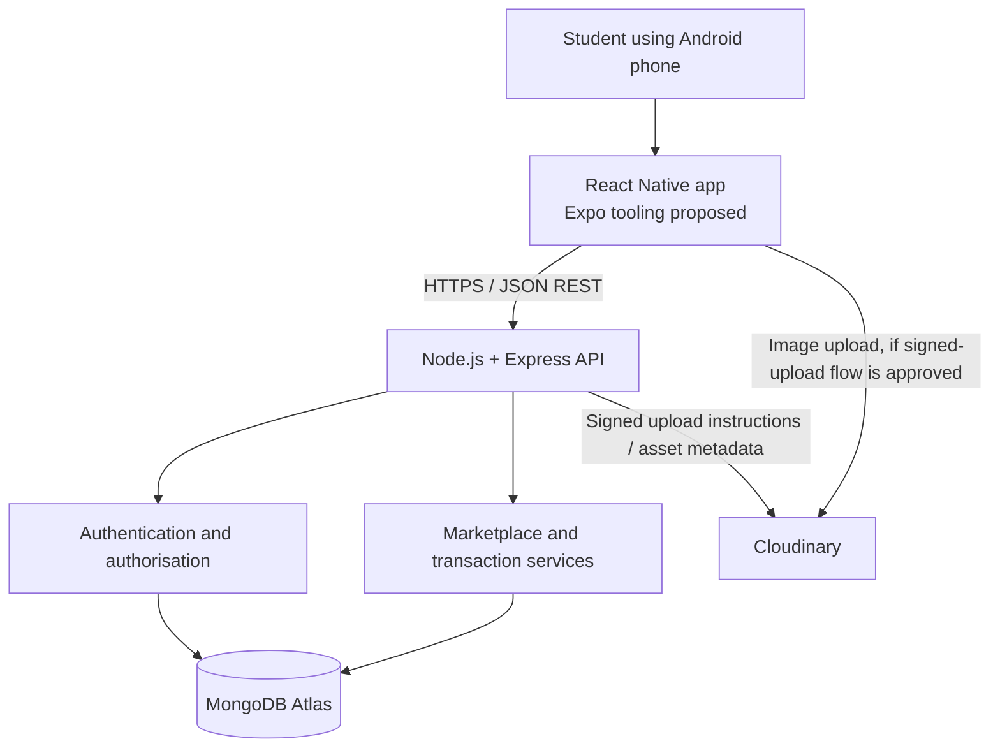

# BorrowBuddy — Technical Design Blueprint

**Document:** System architecture and data/API design draft  
**Version:** 0.1 (draft)  
**Status:** Proposed design; not yet approved for implementation  
**Prepared:** 6 November 2026  
**Companion requirements:** `BorrowBuddy_Requirements_v1.0.md`

> This document translates the current requirements baseline into a technical proposal. It deliberately marks unresolved or provisional choices. Do not treat this draft as an implementation contract until the open decisions in Section 13 are reviewed and the document is promoted to an approved version.

---

## 1. Design goals

1. Use React Native as the only CPAD framework.
2. Keep the mobile application, backend API and database responsibilities separate.
3. Keep development practical on Arch Linux + Hyprland with 4 GB RAM.
4. Enforce all security, ownership and transaction rules on the backend.
5. Make sale and borrowing workflows explicit and auditable.
6. Prevent two users from successfully reserving the same sale item or overlapping borrowing periods.
7. Keep optional features modular so they can be omitted without breaking the core marketplace.

## 2. Proposed system architecture

### 2.1 Logical architecture



### 2.2 Component responsibilities

| Component | Responsibility | Status |
|---|---|---|
| React Native app | Screens, navigation, forms, local UI state and API calls | React Native confirmed; navigation/state libraries not selected |
| Expo tooling | Simplify local development and physical-device testing | Proposed; verify current compatibility before setup |
| Express API | Authentication, validation, authorisation, business logic and REST endpoints | Proposed |
| MongoDB Atlas | Persistent application records | Proposed |
| Cloudinary | Store item image assets and provide image URLs | Proposed |
| Physical Android phone | Run and test the app without a desktop emulator | Proposed test approach |

The mobile app must not connect directly to MongoDB. It must call the backend API. Database credentials and Cloudinary secrets must remain on the server.

### 2.3 Request flow

1. The mobile app sends an HTTPS request to the API.
2. The API validates the request and authenticates the user where required.
3. The API checks ownership, permissions, business rules and current transaction state.
4. The API reads or writes MongoDB records.
5. The API returns a structured response.
6. The mobile app updates the screen based on the returned server state.

The client may perform basic form validation for usability, but backend validation is authoritative.

## 3. Proposed backend module boundaries

Keep the backend modular without introducing microservices.

| Module | Responsibility |
|---|---|
| `auth` | Registration, login, token validation and account access |
| `users` | Student profile and account status |
| `listings` | Listing creation, reading, update, deactivation and discovery |
| `transactions` | Sale/borrow requests, approvals, handover and return lifecycle |
| `reviews` | Transaction-linked reviews, if approved |
| `notifications` | In-app notification records, if approved |
| `reports` | User/listing reports and moderation, if approved |
| `admin` | Protected moderation operations, if approved |

Suggested server layers:

- **Routes:** declare HTTP method and path.
- **Middleware:** authentication, role checks, validation, rate limits and error handling.
- **Controllers:** translate HTTP input/output.
- **Services:** enforce business rules and coordinate database operations.
- **Models/repositories:** define persistence structures and database access.
- **Validators:** validate request bodies, query parameters and identifiers.

Avoid placing transaction business logic directly inside route handlers.

## 4. Proposed MongoDB data model

This is a first-pass model. Exact field names, data types, indexes and embedded/reference choices must be reviewed before implementation.

### 4.1 `users`

Purpose: account identity and student profile.

| Field | Proposed type | Rules / notes |
|---|---|---|
| `_id` | ObjectId | Primary identifier |
| `fullName` | String | Required; trim and length limit |
| `email` | String | Required; normalise case/whitespace; unique index |
| `passwordHash` | String | Required; never return to client |
| `collegeName` | String | Required in proposed student-focused model |
| `profileImage` | Object or null | Optional asset metadata/URL |
| `role` | String enum | Proposed `STUDENT` or `ADMIN` |
| `accountStatus` | String enum | Proposed `ACTIVE` or `SUSPENDED` |
| `emailVerified` | Boolean | Only if email verification is approved |
| `createdAt` | Date | Server-generated |
| `updatedAt` | Date | Server-generated |

Do not store a plaintext password. Do not use an email address as proof of student enrolment unless the college verification policy supports that claim.

### 4.2 `listings`

Purpose: items offered for sale or free lending.

| Field | Proposed type | Rules / notes |
|---|---|---|
| `_id` | ObjectId | Primary identifier |
| `ownerId` | ObjectId reference to users | Required |
| `title` | String | Required; length limit |
| `description` | String | Required; length limit |
| `category` | String or category reference | Initial category strategy is open |
| `condition` | String enum | Candidate values: `NEW`, `LIKE_NEW`, `GOOD`, `FAIR`; confirm labels |
| `images` | Array of objects | Each may hold `url`, `publicId`, and metadata; validate count and size |
| `listingType` | String enum | `SALE` or `LEND` |
| `saleDetails` | Object or null | For `SALE`, contains asking price and currency |
| `lendingDetails` | Object or null | For `LEND`, contains availability rules/notes once defined |
| `status` | String enum | Must respect listing-type-specific lifecycle |
| `createdAt` | Date | Server-generated |
| `updatedAt` | Date | Server-generated |

Proposed sale details:

```json
{
  "saleDetails": {
    "amountMinor": 250000,
    "currency": "INR"
  }
}
```

This example means ₹2,500.00 if the amount is stored in paise. Integer minor units avoid floating-point currency arithmetic. The currency and representation should be confirmed before implementation. No payment is processed by the app.

For a `LEND` listing, `saleDetails` must be absent/null. For a `SALE` listing, `saleDetails.amountMinor` must be a positive integer. The lending availability representation remains open.

#### Listing status proposal

For `SALE`:

- `AVAILABLE`
- `RESERVED`
- `SOLD`
- `INACTIVE`

For `LEND`:

- `ACTIVE`
- `INACTIVE`

Lending availability should be calculated from the listing's availability rules and existing approved/active borrowing periods. Do not mark a lending item permanently reserved just because one future date range is booked.

### 4.3 `transactions`

Purpose: represent a purchase request or borrowing request and its full lifecycle.

| Field | Proposed type | Rules / notes |
|---|---|---|
| `_id` | ObjectId | Primary identifier |
| `listingId` | ObjectId reference to listings | Required |
| `transactionType` | String enum | `SALE` or `BORROW` |
| `requesterId` | ObjectId reference to users | Buyer or borrower |
| `ownerId` | ObjectId reference to users | Seller or lender; snapshot/reference strategy to confirm |
| `status` | String enum | Controlled by backend transition service |
| `requestedStartAt` | Date or null | Required for borrowing if date/time model is selected |
| `expectedReturnAt` | Date or null | Required for borrowing |
| `handover` | Object | Participant acknowledgements and timestamps |
| `return` | Object or null | Borrowing return acknowledgements |
| `createdAt` | Date | Server-generated |
| `updatedAt` | Date | Server-generated |

Proposed handover object:

```json
{
  "handover": {
    "ownerMarkedAt": null,
    "requesterConfirmedAt": null
  }
}
```

Proposed return object for borrowing:

```json
{
  "return": {
    "requesterMarkedReturnedAt": null,
    "ownerConfirmedReturnedAt": null
  }
}
```

These fields are not client-editable as a whole. Dedicated API actions must record the authenticated participant's timestamp after verifying the current state.

#### Sale transaction status proposal

- `PENDING`
- `ACCEPTED`
- `HANDOVER_PENDING_CONFIRMATION`
- `COMPLETED`
- Terminal alternatives: `REJECTED`, `CANCELLED`

Suggested meaning:

- Seller accepts: `PENDING` → `ACCEPTED` and listing becomes `RESERVED`.
- Seller marks physical handover: `ACCEPTED` → `HANDOVER_PENDING_CONFIRMATION`.
- Buyer confirms receipt: `HANDOVER_PENDING_CONFIRMATION` → `COMPLETED`; listing becomes `SOLD`.

#### Borrowing transaction status proposal

- `PENDING`
- `APPROVED`
- `HANDOVER_PENDING_CONFIRMATION`
- `ACTIVE`
- `RETURN_PENDING_CONFIRMATION`
- `COMPLETED`
- Terminal alternatives: `REJECTED`, `CANCELLED`

Suggested meaning:

- Lender approves: `PENDING` → `APPROVED`; reserve the requested period.
- Lender marks handover: `APPROVED` → `HANDOVER_PENDING_CONFIRMATION`.
- Borrower acknowledges receipt: `HANDOVER_PENDING_CONFIRMATION` → `ACTIVE`.
- Borrower marks returned: `ACTIVE` → `RETURN_PENDING_CONFIRMATION`.
- Lender confirms returned item: `RETURN_PENDING_CONFIRMATION` → `COMPLETED`.

Overdue is a derived condition: the borrowing is overdue when the expected return time has passed and the transaction has not reached a state that records return/completion. The exact rule must be aligned with the chosen date/time semantics.

### 4.4 `reviews` (optional)

Suggested fields: `_id`, `transactionId`, `reviewerId`, `recipientId`, `rating`, `comment`, `createdAt`.

Suggested uniqueness: one review per reviewer per transaction. Use a unique compound index only after the review direction and whether both participants may review are finalised.

### 4.5 `notifications` (optional)

Suggested fields: `_id`, `recipientId`, `type`, `title`, `body`, `relatedEntityType`, `relatedEntityId`, `readAt`, `createdAt`.

Do not store unnecessary secrets or sensitive contact details in notification text.

### 4.6 `reports` (optional)

Suggested fields: `_id`, `reporterId`, `targetType`, `targetId`, `reason`, `description`, `status`, `reviewedBy`, `reviewedAt`, `createdAt`.

The permitted report states and moderation audit requirements need definition.

## 5. Relationships

Conceptual relationships:

- One user can own many listings.
- One listing belongs to one owner.
- One listing can have many historical transactions/requests.
- One transaction references one listing, one requester and one owner.
- A completed transaction may have up to two reviews (one in each direction), subject to review policy.
- One user can receive many notifications.
- One report is created by one user and points to one reported user or listing.

Prefer ObjectId references for users, listings and transactions where records are independently queried and have their own lifecycle. Avoid duplicating full user/listing documents inside transactions. If a historical snapshot is needed, store only the specific immutable snapshot fields that are justified (for example, agreed price at acceptance).

## 6. Index and query strategy (proposed)

Candidate indexes to evaluate:

| Collection | Candidate index | Purpose |
|---|---|---|
| `users` | Unique index on normalised `email` | Prevent duplicate accounts |
| `listings` | `{ listingType, status, createdAt }` | Marketplace browsing |
| `listings` | `{ ownerId, createdAt }` | User's listings |
| `listings` | Text index or dedicated search strategy on `title`/`description` | Keyword search; validate language and performance |
| `transactions` | `{ listingId, status }` | Requests and listing lifecycle checks |
| `transactions` | `{ requesterId, createdAt }` | Buyer's/borrower's history |
| `transactions` | `{ ownerId, createdAt }` | Seller's/lender's incoming requests |
| `transactions` | `{ listingId, requestedStartAt, expectedReturnAt }` | Candidate range-conflict lookup; not by itself a complete concurrency guarantee |
| `reviews` | Unique `{ transactionId, reviewerId }` | Prevent duplicate review by a participant, if policy supports this shape |
| `notifications` | `{ recipientId, readAt, createdAt }` | Notification inbox, if implemented |

Do not create every candidate index automatically. Confirm actual queries, collection size expectations and MongoDB index limitations first.

## 7. Critical consistency and concurrency design

### 7.1 Sale request race

A client-side availability check is insufficient. Two buyers may submit requests at nearly the same time.

When a seller accepts a request, the backend must atomically:

1. Confirm the listing is still `AVAILABLE`.
2. Confirm the request is still `PENDING` and belongs to that listing.
3. Confirm the actor is the listing owner.
4. Change the listing to `RESERVED`.
5. Change the accepted transaction to `ACCEPTED`.
6. Close or invalidate other pending requests for that listing.

The precise MongoDB write strategy (transaction, conditional update, version/CAS pattern or combination) must be selected and tested against the deployed Atlas configuration. Do not assume a normal read-then-write sequence is race-safe.

### 7.2 Borrowing period overlap

When a lender approves a request, the backend must re-check for conflicts at approval time.

For a proposed half-open interval `[requestedStartAt, expectedReturnAt)`, two periods overlap when:

`existingStart < requestedEnd AND existingEnd > requestedStart`.

This interval convention is only a proposal; date-only vs date-time and timezone rules remain open.

Potentially blocking states include `APPROVED`, `HANDOVER_PENDING_CONFIRMATION`, `ACTIVE` and `RETURN_PENDING_CONFIRMATION`. The final conflict rule must consider the actual item custody period and agreed cancellation policy.

MongoDB does not provide a simple unique index that enforces arbitrary date-range non-overlap. A safe per-listing serialisation/conditional-write strategy is required. This must be designed and concurrency-tested before the borrowing approval endpoint is considered complete.

### 7.3 Idempotency and retries

Mobile clients may retry after timeouts. For operations that create transactions or advance states, use an idempotency strategy or conditional state transition so a repeated request does not create duplicate transactions or repeat a completed action.

The design should define which endpoints accept an `Idempotency-Key`, how long keys are retained and what response is returned for a repeated action.

### 7.4 State transition guard

Implement transaction state changes through service functions such as:

- `acceptSaleRequest`
- `rejectSaleRequest`
- `markSaleHandover`
- `confirmSaleReceipt`
- `approveBorrowRequest`
- `markBorrowHandover`
- `confirmBorrowReceipt`
- `markBorrowReturned`
- `confirmBorrowReturn`

Each function must verify: authenticated user, participant role, current status, listing status, dates/availability, and any duplicate-action condition.

## 8. Proposed REST API outline

Base path proposal: `/api/v1`.

This is an endpoint inventory, not a final API contract. Exact payloads, validation schemas, pagination and error details must be specified before coding.

### 8.1 Authentication and profile

| Method | Path | Purpose | Auth |
|---|---|---|---|
| `POST` | `/auth/register` | Register account | Public |
| `POST` | `/auth/login` | Authenticate | Public |
| `POST` | `/auth/logout` | Logout/revoke session if supported by token design | Auth |
| `POST` | `/auth/refresh` | Refresh token if refresh-token model is selected | Refresh credential |
| `GET` | `/users/me` | Get own profile | Auth |
| `PATCH` | `/users/me` | Update own permitted profile fields | Auth |

### 8.2 Listings

| Method | Path | Purpose | Auth |
|---|---|---|---|
| `GET` | `/listings` | Browse/search/filter/paginate listings | Public or auth; decide guest policy |
| `POST` | `/listings` | Create listing | Auth |
| `GET` | `/listings/:listingId` | View listing details | Public or auth; decide guest policy |
| `PATCH` | `/listings/:listingId` | Edit own eligible listing | Auth + owner check |
| `POST` | `/listings/:listingId/deactivate` | Deactivate own eligible listing | Auth + owner check |

### 8.3 Transactions

| Method | Path | Purpose | Auth |
|---|---|---|---|
| `POST` | `/listings/:listingId/transactions` | Create sale or borrowing request | Auth |
| `GET` | `/transactions` | List user's incoming/outgoing transactions | Auth |
| `GET` | `/transactions/:transactionId` | View transaction detail | Auth + participant check |
| `POST` | `/transactions/:transactionId/accept` | Accept sale request | Auth + owner check |
| `POST` | `/transactions/:transactionId/reject` | Reject request | Auth + owner check |
| `POST` | `/transactions/:transactionId/withdraw` | Withdraw eligible pending request | Auth + requester check |
| `POST` | `/transactions/:transactionId/mark-handover` | Owner/seller/lender records physical handover | Auth + owner check |
| `POST` | `/transactions/:transactionId/confirm-receipt` | Requester/buyer/borrower confirms receipt | Auth + requester check |
| `POST` | `/transactions/:transactionId/mark-returned` | Borrower records return to lender | Auth + requester check; borrowing only |
| `POST` | `/transactions/:transactionId/confirm-return` | Lender confirms returned item | Auth + owner check; borrowing only |

The `accept` action must dispatch to the correct sale or borrow rules based on the transaction/listing type. Avoid one generic status-update endpoint.

### 8.4 Optional features

| Method | Path | Purpose |
|---|---|---|
| `GET` | `/notifications` | List current user's notifications |
| `POST` | `/notifications/:id/read` | Mark notification as read |
| `POST` | `/transactions/:id/reviews` | Submit eligible review |
| `POST` | `/reports` | Create report |
| `GET` | `/admin/reports` | Admin review queue |
| `POST` | `/admin/reports/:id/actions` | Apply moderation action |

## 9. API response and error conventions

Proposed success response shape:

```json
{
  "data": {},
  "meta": {}
}
```

Proposed error response shape:

```json
{
  "error": {
    "code": "VALIDATION_ERROR",
    "message": "The request could not be processed.",
    "details": []
  },
  "requestId": "server-generated-id"
}
```

Use appropriate HTTP status codes, for example:

- `200` successful read/update/action.
- `201` resource created.
- `400` malformed or invalid input.
- `401` missing/invalid authentication.
- `403` authenticated but not authorised.
- `404` resource not found or deliberately concealed.
- `409` conflict, stale state or unavailable listing period.
- `429` rate limit exceeded.
- `500` unexpected server error.

Do not expose stack traces, password hashes, secrets or internal database errors to the mobile client.

## 10. Mobile screen inventory (proposed)

### 10.1 Public/authentication screens

- Welcome / entry screen.
- Register.
- Login.
- Email verification / password recovery, if approved.

### 10.2 Main student application

- Home / marketplace feed.
- Search and filters.
- Listing details.
- Create listing.
- Edit listing.
- My listings.
- Incoming requests.
- Outgoing requests.
- Transaction details and confirmation actions.
- Profile and profile editing.
- Activity/history.

### 10.3 Conditional screens

- Notifications inbox, if retained.
- Review form and received reviews, if retained.
- Report form, if retained.
- Admin moderation screens, if retained.

Navigation library and tab structure are not yet selected. Choose the lightest maintainable approach that supports the screen flow and current React Native tooling.

## 11. Proposed repository layout

A simple monorepo-style folder layout is suggested so mobile and backend code remain together while retaining separate dependencies.

```text
BorrowBuddy/
├── docs/
│   ├── BorrowBuddy_Requirements_v1.0.md
│   └── BorrowBuddy_Technical_Design_v0.1.md
├── mobile/
│   ├── src/
│   │   ├── components/
│   │   ├── screens/
│   │   ├── navigation/
│   │   ├── services/
│   │   ├── hooks/
│   │   ├── types/
│   │   └── utils/
│   └── package.json
├── backend/
│   ├── src/
│   │   ├── config/
│   │   ├── middleware/
│   │   ├── modules/
│   │   ├── validators/
│   │   ├── utils/
│   │   └── app.ts
│   └── package.json
├── .gitignore
└── README.md
```

The exact file structure and JavaScript/TypeScript choice must be finalised before scaffolding. Do not install dependencies merely to create empty folders.

## 12. Testing strategy

### 12.1 Backend tests

- Registration validation and duplicate email.
- Login success/failure and protected routes.
- Listing ownership and validation.
- Search/filter/pagination.
- Purchase request creation, accept, reject and withdraw.
- Borrowing date validation and overlapping-period rejection.
- Every allowed and disallowed state transition.
- Cross-user access attempts.
- Duplicate/retry behaviour.
- Concurrent acceptance attempts for the same sale item.
- Concurrent approval attempts for overlapping borrowing periods.

### 12.2 Mobile tests

- Navigation and form validation.
- Loading, empty, success and error states.
- Login persistence and logout.
- Listing creation and image upload.
- Purchase and borrowing request flows.
- Handling stale listing/transaction state after another user acts.
- Physical-device network access to the development API.

### 12.3 Completion evidence

Record actual test cases, input data, expected results, observed results and pass/fail outcome. Do not mark tests as passed without executing them.

## 13. Open decisions required before implementation

| ID | Decision | Design impact |
|---|---|---|
| TD-01 | Student verification policy | Registration fields, verification flow, trust model |
| TD-02 | Guest listing visibility | API access and navigation |
| TD-03 | Email verification and email provider | Auth and external service |
| TD-04 | Offline coordination method after acceptance | Contact privacy and screens |
| TD-05 | Free lending only or paid rental later | Listing schema and business rules |
| TD-06 | Lending date-only or date-and-time | Date storage, timezone and overlap rules |
| TD-07 | Can multiple non-overlapping future requests be approved for one item? | Reservation model |
| TD-08 | Cancellation rules after approval/handover | State machine and inventory availability |
| TD-09 | One-sided handover/return confirmation handling | Completion and dispute flow |
| TD-10 | Notifications, reviews, reports/admin in first release? | Collections, endpoints and screens |
| TD-11 | Item category and condition vocabularies | Validation and filters |
| TD-12 | Image limits and upload strategy | Cloudinary and validation |
| TD-13 | JWT access/refresh strategy and mobile secure storage | Auth security |
| TD-14 | TypeScript confirmation and navigation/state libraries | Project setup |
| TD-15 | Exact course evaluation and documentation requirements | Scope and final submission |

## 14. Recommended implementation order after design approval

1. Freeze decisions that affect schema and lifecycle.
2. Finalise schema, indexes and validation.
3. Finalise API contract and transaction transition table.
4. Verify current React Native/Expo, Node.js and MongoDB tooling requirements before installation.
5. Set up Git repository and lightweight development environment.
6. Build and test backend health/config/database connection.
7. Build authentication and user profile APIs.
8. Build listings and marketplace APIs.
9. Build sale and borrowing transaction services, including concurrency tests.
10. Build mobile navigation and authentication.
11. Integrate listings and transaction flows.
12. Add only the optional features that remain within the approved scope.

**Do not start implementation from this draft until the open decisions and critical concurrency design are reviewed.**

---

## 15. Design change log

| Version | Date | Change |
|---|---|---|
| 0.1 | 6 November 2026 | Initial architecture, conceptual MongoDB model, REST API inventory, screen inventory and testing strategy drafted from requirements baseline v1.0. Not approved for implementation. |

**End of technical design draft v0.1.**
