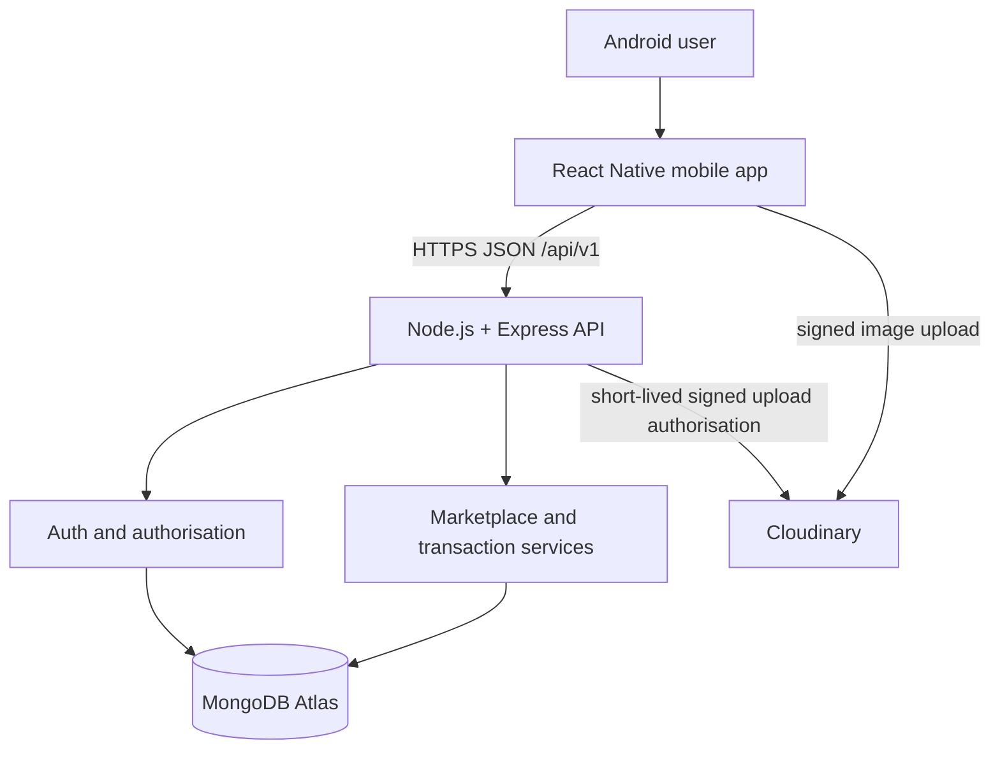

# BorrowBuddy — Technical Design

**Document:** Reconciled system architecture and technical design
**Version:** 0.2
**Status:** Owner-approved direction with technical recommendations awaiting approval
**Prepared:** 14 November 2026
**Supersedes:** `BorrowBuddy_Technical_Design_v0.1.md`
**Companion contract:** `BorrowBuddy_Database_API_Contract_v1.1.md`

## 1. Design authority and status

This document reconciles the historical draft with owner-approved decisions in
`BORROWBUDDY_AGENT_HANDOFF.md`. It is a design document, not evidence of implementation
or testing. Product rules marked approved are authoritative. Choices explicitly marked
awaiting approval must not be silently treated as fixed implementation requirements.

## 2. Architecture



React Native is the only CPAD framework. Expo is tooling. The mobile app never connects
directly to MongoDB and never contains database or Cloudinary secrets. The backend owns
validation, permissions, lifecycle transitions, transaction orchestration and
notifications.

Keep one modular Node.js/Express backend; do not introduce microservices. Suggested
modules are `auth`, `users`, `listings`, `transactions`, `uploads`, `notifications`,
`reviews`, `reports` and `admin`, separated into routes, middleware, controllers,
services, repositories/models and validators.

## 3. Approved product-to-technical mapping

- Guest `GET` listing/profile reads are public; account and transaction actions require
  authentication.
- `SALE` and free `LEND` are the only listing types.
- College affiliation is a self-declared `collegeName`.
- Images are optional signed Cloudinary uploads: each listing contains 0–5
  server-validated JPEG/PNG/WebP assets targeted at 5 MB each.
- Timestamps are server-generated UTC instants. Lending dates are date-only
  `YYYY-MM-DD` values interpreted in `Asia/Kolkata`; same-day and multi-day ranges are
  valid, while an end date before the start date is invalid.
- Listing images are optional: each listing contains 0–5 server-verified JPEG/PNG/WebP
  assets, targeted at no more than 5 MB each.
- State changes use dedicated actions, not a generic status patch.
- Contact sharing is an explicit participant action after acceptance only.

## 4. Data and lifecycle design

The normative collection fields, indexes, endpoints and payloads are in
`BorrowBuddy_Database_API_Contract_v1.1.md`. The core collections are `users`,
`listings`, `transactions`, `notifications`, `reviews`, `reports` and
`adminAuditLogs`; a `sessions` collection is a technical recommendation for
multi-device refresh sessions.

### 4.1 Listing rules

Sale statuses are `AVAILABLE`, `RESERVED`, `SOLD`, `INACTIVE`. Lending statuses are
`ACTIVE`, `INACTIVE`; lending availability is calculated from blocking transactions.
Each listing has an integer `reservationVersion`, changed conditionally inside a
reservation transaction.

### 4.2 Shared transaction states

The only persisted transaction statuses are:

`PENDING`, `ACCEPTED`, `HANDOVER_PENDING`, `ACTIVE`, `RETURN_PENDING`, `COMPLETED`,
`REJECTED`, `CANCELLED`, `CANCELLED_BY_ADMIN`.

`ACTIVE` and `RETURN_PENDING` apply to borrowing; sale uses `PENDING`,
`ACCEPTED`, `HANDOVER_PENDING` and `COMPLETED` plus terminal outcomes. `OVERDUE` is
derived only for qualifying `ACTIVE` borrowing records.

### 4.3 State transitions

| Type | Current | Action | Next | Actor |
|---|---|---|---|---|
| Sale/borrow | — | Create request | `PENDING` | requester |
| Sale/borrow | `PENDING` | Accept/approve | `ACCEPTED` | listing owner |
| Sale/borrow | `PENDING` | Reject | `REJECTED` | listing owner |
| Sale/borrow | `PENDING` | Withdraw | `CANCELLED` | requester |
| Sale | `ACCEPTED` | Seller marks handover | `HANDOVER_PENDING` | seller |
| Sale | `HANDOVER_PENDING` | Buyer confirms receipt | `COMPLETED` | buyer |
| Borrow | `ACCEPTED` | Lender marks handover | `HANDOVER_PENDING` | lender |
| Borrow | `HANDOVER_PENDING` | Borrower confirms receipt | `ACTIVE` | borrower |
| Borrow | `ACTIVE` | Borrower marks return | `RETURN_PENDING` | borrower |
| Borrow | `RETURN_PENDING` | Lender confirms return | `COMPLETED` | lender |
| Borrow | `RETURN_PENDING` | Lender disputes return | `ACTIVE` | lender, reason required |
| Sale/borrow | `ACCEPTED` | Cancel with reason | `CANCELLED` | either participant |
| `PENDING`/`ACCEPTED` | Admin cancellation | `CANCELLED_BY_ADMIN` | admin, reason required |

Ordinary cancellation is unavailable once `HANDOVER_PENDING` begins. The defined admin
cancellation action is limited to `PENDING` and `ACCEPTED`; post-handover admin issue
resolution is a separate unresolved policy question. Every transition appends history
and creates appropriate in-app notifications atomically where the operation spans
multiple records.

## 5. Borrow availability and concurrency

Use the inclusive predicate everywhere:

```text
newStart <= existingEnd AND newEnd >= existingStart
```

The backend permits `startDate == expectedReturnDate` and
`startDate < expectedReturnDate`, rejects `startDate > expectedReturnDate`, and does
not introduce time-of-day fields. A same-day booking conflicts with any blocking booking
whose inclusive range contains that date.

For configured lending limits, calculate
`durationDays = calendarDaysBetween(startDate, expectedReturnDate) + 1`. A same-day
request therefore has duration 1; 10–16 November has duration 7; and validation
requires `minDays <= durationDays <= maxDays`.

Only `ACCEPTED`, `HANDOVER_PENDING`, `ACTIVE` and `RETURN_PENDING` borrowings block.
Pending requests do not.

Borrow approval must run in a MongoDB Atlas deployment supporting multi-document
transactions:

1. Start a session/transaction and read the active lending listing.
2. Conditionally increment `reservationVersion` from the observed value.
3. Recheck overlapping blocking transactions inside that same transaction.
4. If clear, change the request from `PENDING` to `ACCEPTED`, append history and write
   the approval notification atomically.
5. Commit; abort on conflict.
6. Retry transient transaction/write conflicts a bounded number of times, then return a
   documented conflict/internal error without a success-shaped fallback.

Sale acceptance similarly conditionally changes `AVAILABLE` to `RESERVED`, accepts one
pending request and closes competing pending requests in one transaction.

Accepted-sale cancellation uses a transaction and a conditional listing update:
the listing may return to `AVAILABLE` only when its status is `RESERVED`, its
`reservedByTransactionId` matches the cancelling transaction, and no completed sale
exists. The transaction becomes `CANCELLED`, history and cancellation notifications
are written atomically, and competing pending requests remain closed. A stale,
duplicate or already-sold action aborts without restoring the listing. Accepted-borrow
cancellation changes the transaction, history and notifications atomically; its date
range stops blocking only after that commit.

The design must not claim concurrency safety until parallel-approval integration tests
pass against the actual transaction-capable Atlas deployment. A mock or in-memory
database is insufficient evidence.

## 6. Security and privacy

Use password hashing, HTTPS in deployed environments, secure mobile storage, short-lived
access tokens, refresh rotation/revocation, server-side role/ownership checks,
allowlisted field mapping, rate limiting for sensitive routes and signed Cloudinary
uploads. Do not log secrets or contact details. Contact data is returned only to the
relevant transaction participant after the sharing participant opts in.

## 7. Client architecture and release order

The mobile app contains public browsing/authentication, listing, request, transaction,
notification, review and protected admin screens as their approved priority permits.
Backend state is authoritative; screens handle loading, empty, stale-state, conflict and
error responses.

Recommended implementation order after owner review:

1. Backend configuration, health and Atlas connection.
2. Authentication/profile and secure refresh sessions.
3. Signed uploads and listing APIs.
4. Sale lifecycle and atomic acceptance.
5. Borrow lifecycle, overlap checks and Atlas-backed concurrency tests.
6. In-app notifications.
7. Mobile integration.
8. Reviews, reports and admin moderation after core flows are stable.

## 8. Technical recommendations awaiting approval

- Exact access-token lifetime, refresh-session lifetime, multi-device policy and
  password-reset provider.
- Whether refresh sessions use a separate collection or one per-user hash.
- Exact bounded retry count/backoff and transaction error mapping.
- Navigation/state/validation libraries and search strategy.
- Whether transaction history remains embedded or becomes a separate collection after
  query-volume review.
- Exact performance targets and supported Android OS range.

These choices affect implementation detail but do not change the approved product scope.

## 9. Change log

| Version | Date | Change |
|---|---|---|
| 0.1 | 6 November 2026 | Historical architecture draft. |
| 0.2 | 14 November 2026 | Reconciled approved stack, scope, privacy, enums, lifecycle, date semantics, atomic approval and implementation priority; separated technical recommendations awaiting approval. |
